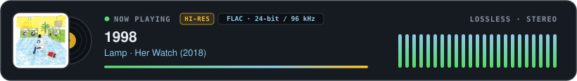

  
✦ building simple, clean, and usable apps — web & mobile ✦

  
  
  

 

### ✦ About Me

`›` Suka ngulik dan bikin berbagai macam aplikasi, dari web sampai mobile.

`›` Lagi terus belajar dan nyoba teknologi baru lewat project-project kecil.

`›` Suka ngubah ide yang awalnya ribet jadi sesuatu yang lebih simpel dan bisa dipakai.

`›` Tertarik juga sama UI/UX dan gimana bikin aplikasi yang enak dilihat sekaligus nyaman digunakan.

 
🏙️ <i>The city I built this year — every building is a day; taller means more contributions.</i>

 

  

### ✦ Tech Stack

  
  
  
  
  
  
   
  
  
  
  
  
  

  

  

  

### ✦ Let's Connect

 

Jangan ragu buat ngobrol atau nyapa aku lewat platform di bawah ini ya! Terbuka buat diskusi seputar web, mobile, atau kolaborasi project.

 

 

 

  
   
  ✦ thanks for stopping by ✦
    
  

